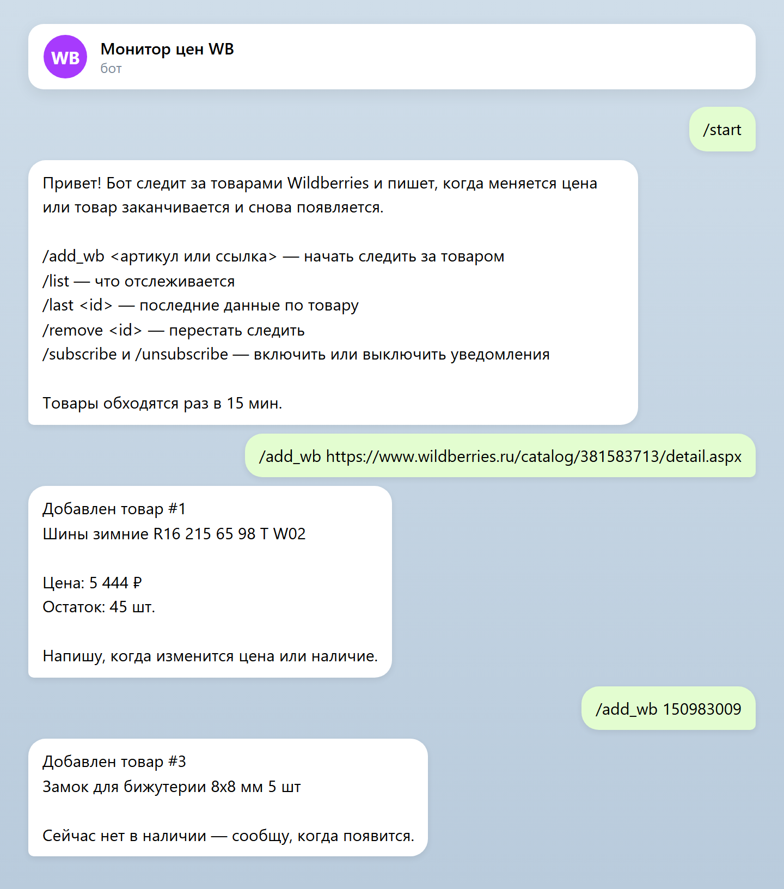
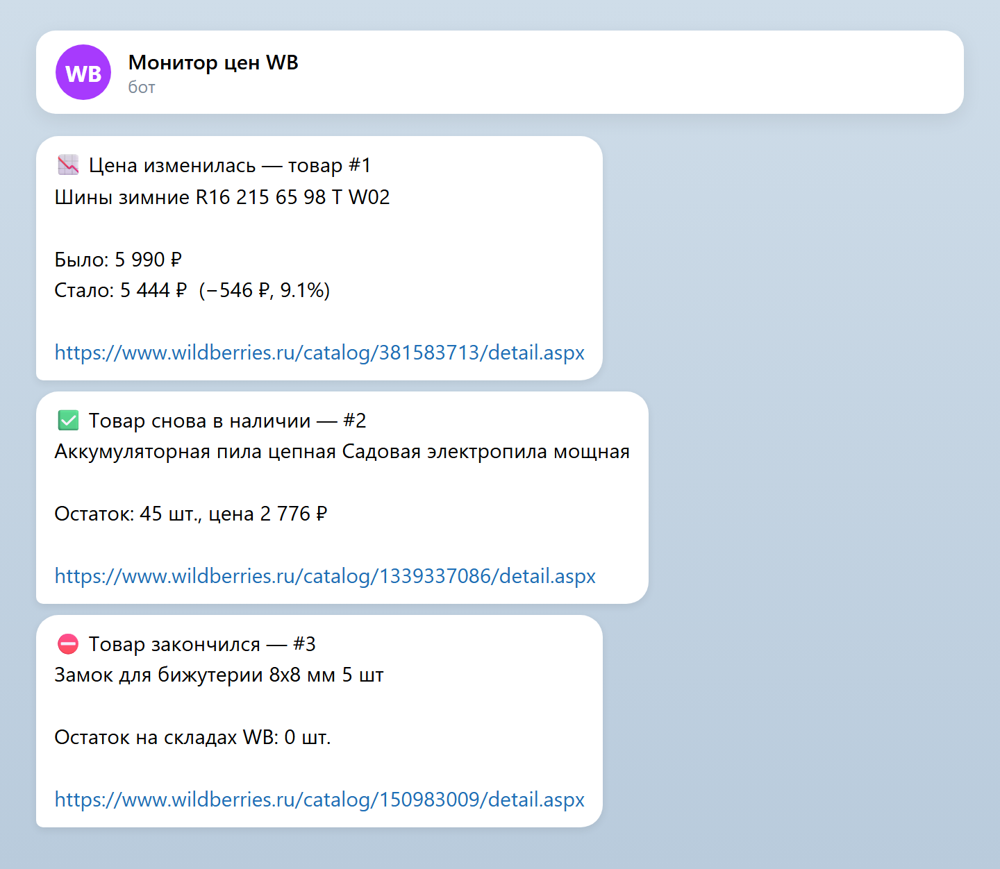
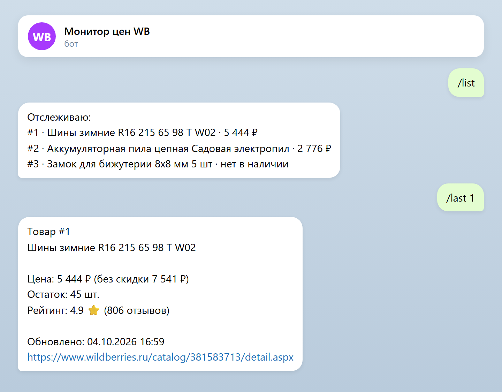
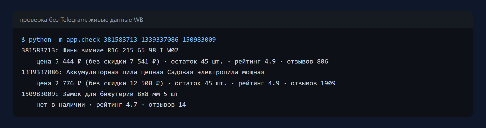
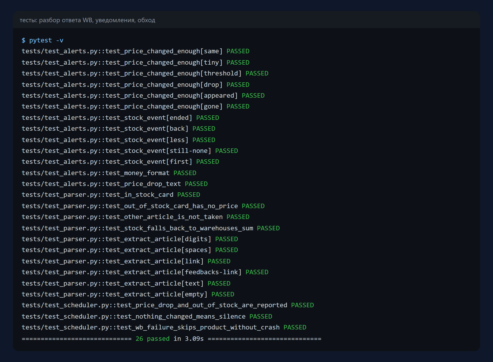

# Wildberries price monitoring

[Русская версия](README.md)

A Telegram bot that watches products on Wildberries (a large Russian marketplace)
and messages you when the price changes or a product goes out of stock and comes
back in stock. All you need to do is send an article number or a product link.

Python 3.11+ · aiogram 3 · Playwright · SQLAlchemy · APScheduler · pytest

| Adding a product | Notifications |
|---|---|
|  |  |

## Features

- `/add_wb <article number or link>` — start watching a product; the bot immediately
  shows the current price and stock;
- `/list` — what is being tracked and at what price now;
- `/last <id>` — the latest snapshot: price, price before discount, stock, rating, reviews;
- `/remove <id>`, `/subscribe`, `/unsubscribe`;
- on a schedule it goes through all products and sends:
  - 📉📈 a price change — with the difference in rubles and percent (small fluctuations
    below the threshold do not bother you);
  - ⛔ product out of stock and ✅ back in stock.



## How the data is obtained

Wildberries returns prices and stock only after an "are you a bot" check, which
a regular browser passes. So the parser opens the product page in Chromium
through Playwright and intercepts the API response that the page itself requests.
Parsing of this response (`parse_card` in `app/parsers/wb.py`) is separated from the browser and
covered by tests on real WB responses — in stock and out of stock.

In one pass the browser is started once for all products. If a product did not
open (network, timeout), it is skipped until the next pass — the rest
are processed as usual.

WB does not let you through without a browser window: on a desktop the window is moved off screen,
on a server the bot runs under a virtual display.

You can check what the bot sees without Telegram:

```bash
python -m app.check 381583713 https://www.wildberries.ru/catalog/1339337086/detail.aspx
```



## Running

```bash
pip install -r requirements.txt
playwright install chromium
cp .env.example .env        # put in TELEGRAM_TOKEN
python -m app.bot
```

On a headless Linux server:

```bash
sudo apt install xvfb
xvfb-run -a python -m app.bot
```

Settings are in `.env.example`: token, database, check interval, price notification
threshold, browser timeout.

> The WB site may not respond to foreign IP addresses. If the server or VPN is
> abroad, route the domains `wildberries.ru`, `wb.ru`, `wbbasket.ru`,
> `wbstatic.net` directly.

## Tests

```bash
pytest -v
```

Parsing of the WB response, notification rules (price threshold, availability) and a full pass on
an in-memory database with WB and Telegram replaced: a price drop and "out of stock"
reach subscribers, the bot stays silent when the data has not changed, a failure on one product
does not break the pass.



## Structure

```
app/bot.py          Telegram commands
app/scheduler.py    scheduled pass, snapshots and notifications
app/alerts.py       notification rules and texts
app/parsers/wb.py   browser, interception of the WB response and its parsing
app/check.py        check without Telegram
app/models.py       users, products, snapshots
tests/              tests and sample WB responses
```

## License

MIT — see [LICENSE](LICENSE).
