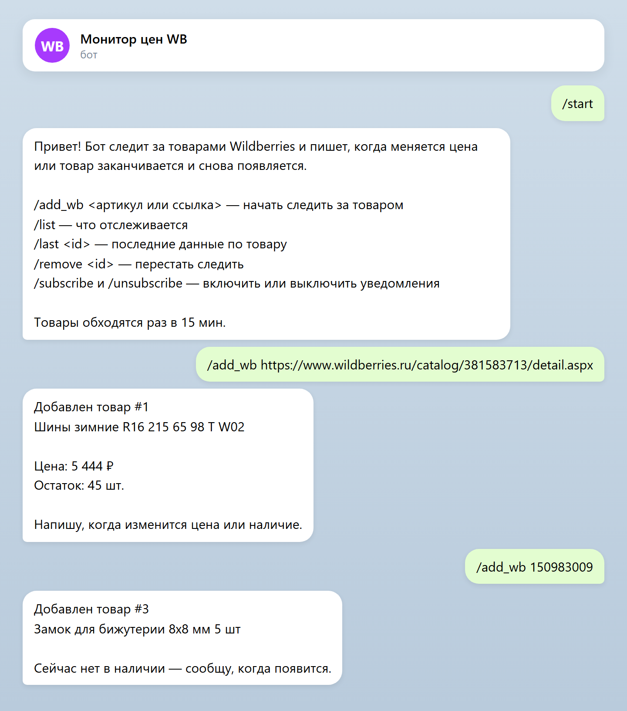
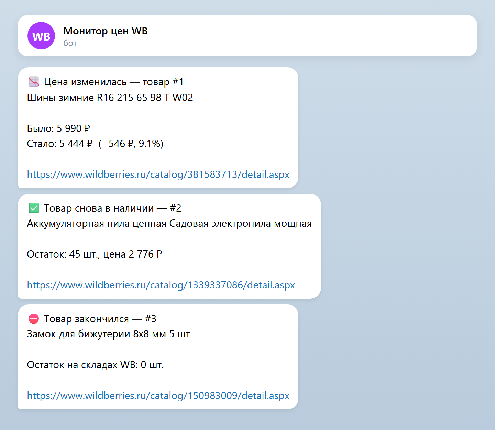
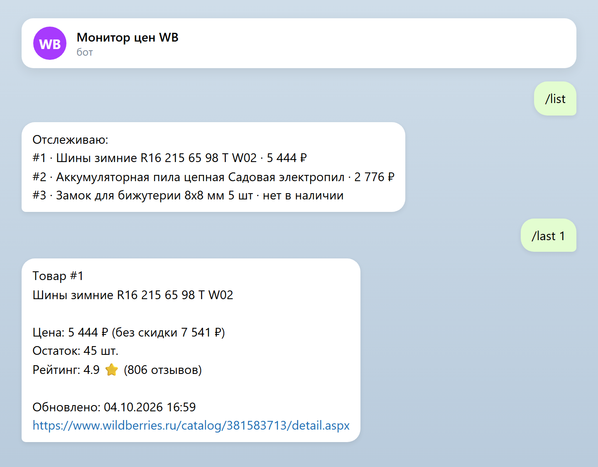
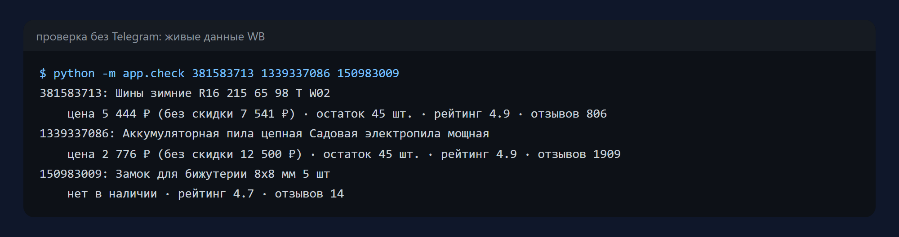
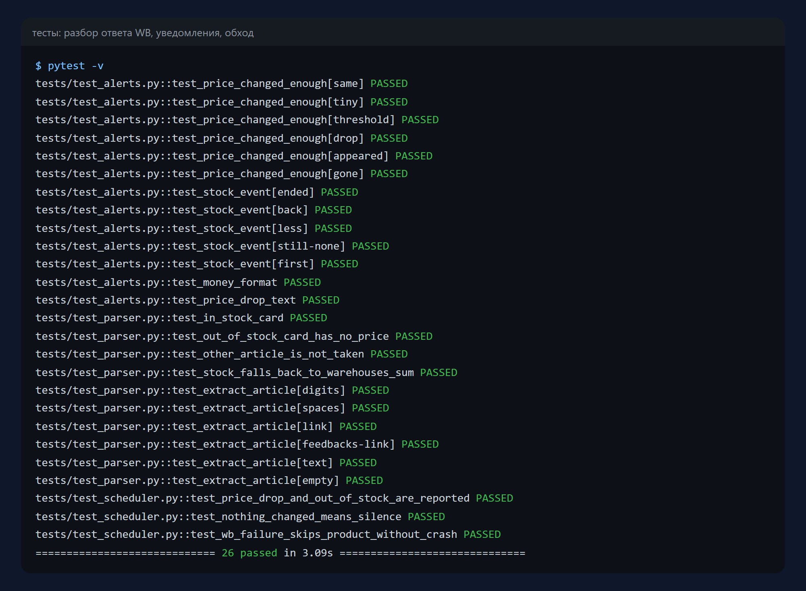

# Мониторинг цен Wildberries

Telegram-бот следит за товарами Wildberries и пишет, когда меняется цена или
товар заканчивается и снова появляется в наличии. Достаточно прислать артикул
или ссылку на товар.

Python 3.11+ · aiogram 3 · Playwright · SQLAlchemy · APScheduler · pytest

| Добавление товара | Уведомления |
|---|---|
|  |  |

## Что умеет

- `/add_wb <артикул или ссылка>` — начать следить за товаром; бот сразу
  показывает текущую цену и остаток;
- `/list` — что отслеживается и почём сейчас;
- `/last <id>` — последний срез: цена, цена до скидки, остаток, рейтинг, отзывы;
- `/remove <id>`, `/subscribe`, `/unsubscribe`;
- по расписанию обходит все товары и присылает:
  - 📉📈 изменение цены — с разницей в рублях и процентах (мелкие колебания
    ниже порога не беспокоят);
  - ⛔ товар закончился и ✅ снова в наличии.



## Как достаются данные

Цены и остатки Wildberries отдаёт только после проверки «вы не бот», которую
проходит обычный браузер. Поэтому парсер открывает карточку товара в Chromium
через Playwright и перехватывает ответ API, который запрашивает сама страница.
Разбор этого ответа (`parse_card` в `app/parsers/wb.py`) отделён от браузера и
проверен тестами на настоящих ответах WB — в наличии и без наличия.

За один обход браузер запускается один раз на все товары. Если товар не
открылся (сеть, таймаут), он пропускается до следующего обхода — остальные
обрабатываются как обычно.

Без окна браузера WB не пропускает: на компьютере окно уводится за край экрана,
на сервере бот запускается под виртуальным дисплеем.

Проверить, что видит бот, можно без Telegram:

```bash
python -m app.check 381583713 https://www.wildberries.ru/catalog/1339337086/detail.aspx
```



## Запуск

```bash
pip install -r requirements.txt
playwright install chromium
cp .env.example .env        # впишите TELEGRAM_TOKEN
python -m app.bot
```

На Linux-сервере без экрана:

```bash
sudo apt install xvfb
xvfb-run -a python -m app.bot
```

Настройки — в `.env.example`: токен, база, интервал обхода, порог уведомления
о цене, таймаут браузера.

> Сайт WB может не отвечать на зарубежные адреса. Если сервер или VPN за
> границей, пустите домены `wildberries.ru`, `wb.ru`, `wbbasket.ru`,
> `wbstatic.net` напрямую.

## Тесты

```bash
pytest -v
```

Разбор ответа WB, правила уведомлений (порог цены, наличие) и полный обход на
базе в памяти с подменёнными WB и Telegram: снижение цены и «закончился»
приходят подписчикам, при неизменных данных бот молчит, сбой по одному товару
не ломает обход.



## Структура

```
app/bot.py          команды Telegram
app/scheduler.py    обход по расписанию, срезы и уведомления
app/alerts.py       правила и тексты уведомлений
app/parsers/wb.py   браузер, перехват ответа WB и его разбор
app/check.py        проверка без Telegram
app/models.py       пользователи, товары, срезы
tests/              тесты и образцы ответов WB
```

## Лицензия

MIT — см. [LICENSE](LICENSE).
